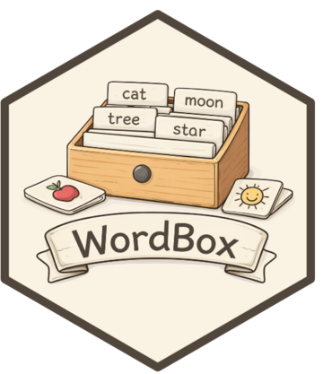

<!-- README.md is generated from README.Rmd. Please edit that file -->

```{r, include = FALSE}
knitr::opts_chunk$set(
  collapse = TRUE,
  comment = "#>",
  fig.path = "man/figures/README-",
  out.width = "100%"
)
```

# WordBox 

<!-- badges: start -->
[](https://github.com/stibu81/WordBox/actions)
[](https://app.codecov.io/gh/stibu81/WordBox)
<!-- badges: end -->

WordBox is a simple word trainer written in R using
[shiny](https://shiny.rstudio.com/).


## Installation

WordBox is not currently available on [CRAN](https://CRAN.R-project.org)
but you can install the current version from [GitHub](https://github.com/) with:

``` r
# install.packages("devtools")
devtools::install_github("stibu81/WordBox")
```
